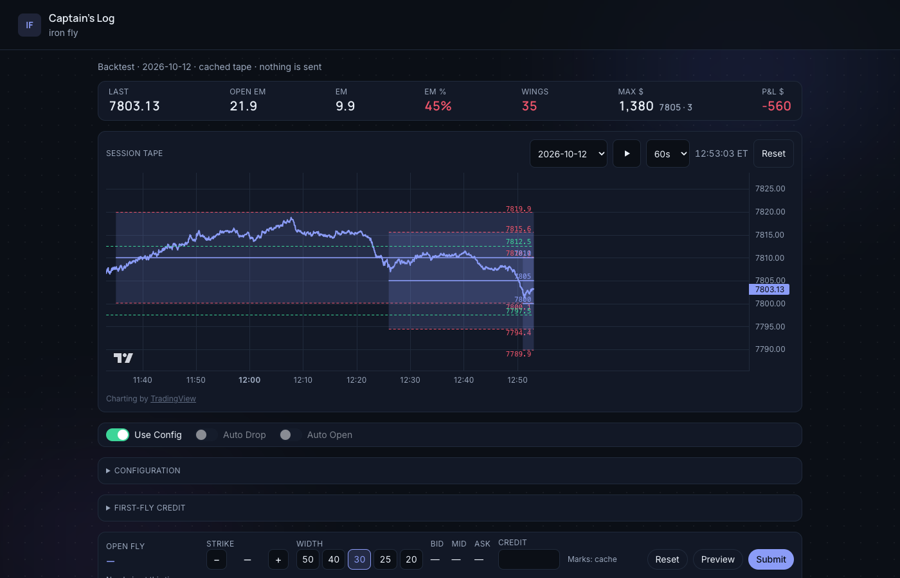
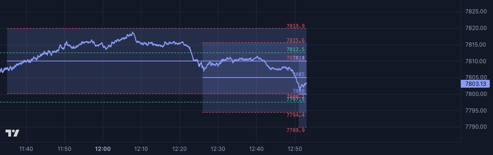

# Dale's IronFly Replay / Backtest Tool

Docker-first **Dale's** SPX 0DTE iron-fly **backtest** desk and CLI.
Inspired by [Dale's iron fly on YouTube](https://www.youtube.com/watch?v=kNR2r8Nj3qI).

Strategy rules come from
[`iron_fly_strategy@v0.1.1`](https://github.com/askosyrskiy/iron_fly_strategy).
Session tapes are gzipped on Cloudflare R2 (~1.5 MB/day). Each day file stores
**SPX prints every 1 second** and the **option chain every 2 seconds**.



<p align="center">
  
</p>

Short clip (same run, H.264): [`docs/media/replay-60s.mp4`](docs/media/replay-60s.mp4)

## Web UI

The desk replays a cached session tape. Nothing is sent to a broker.
Default configuration is `config/default.yaml` (paste/Apply in **Configuration**, or leave empty and the UI loads that file).

### Local Python

```bash
cp .env.example .env
python3.12 -m venv .venv && source .venv/bin/activate
pip install -e ".[dev]"   # pulls iron-fly-strategy@v0.1.1 from GitHub

make run-local            # hydrate last 10 days from R2, then serve
# open http://localhost:8000
```

If `replay/` is already warm, skip the download:

```bash
make run-ui               # serve only → http://localhost:8000
```

Port comes from `LISTEN_PORT` in `.env` (default `8000`).

### Docker

```bash
cp .env.example .env
make run-docker           # docker compose up --build
# open http://localhost:8000
```

On container start the entrypoint downloads the newest **10** days into the
`replay` volume, then serves the Web UI.

Useful once the stack is up:

```bash
make download-replay ARGS='--last 30'
```

### Deploy to Lightsail

Deploys the public desk to the smallest Amazon Lightsail **container service**
(`iron-fly`, power `micro`, scale `1`). Lightsail terminates TLS and forwards
HTTPS to HTTP port `8000` in the container.

**Prerequisites**

1. [AWS CLI](https://docs.aws.amazon.com/cli/) v2, logged in (`aws login` or
   configured credentials) with permission to manage Lightsail container services
   in your region (default `us-east-1`).
2. [Docker](https://docs.docker.com/get-docker/) running locally (builds
   `linux/amd64`).
3. [lightsailctl](https://lightsail.aws.amazon.com/ls/docs/en_us/articles/amazon-lightsail-install-software)
   on `PATH` (or `~/.local/bin`) so `aws lightsail push-container-image` works.
4. A project venv with deps (the deploy script uses `.venv/bin/python` to sync
   R2):

```bash
cp .env.example .env          # optional: set REPLAY_BOOTSTRAP_DAYS / R2_PUBLIC_BASE
python3.12 -m venv .venv && source .venv/bin/activate
pip install -e .
```

**Deploy**

```bash
./scripts/deploy-lightsail.sh
```

What the script does:

1. Syncs the newest `REPLAY_BOOTSTRAP_DAYS` (default **10**) from the public R2
   `manifest.json` into local `replay/` via `scripts/download-replay.py`.
2. Fails if that sync cannot run and `replay/` has no `YYYY-MM-DD.json` files.
3. Creates the Lightsail service if needed, builds `iron-fly:public`, pushes the
   image, and creates a deployment with `REPLAY_HYDRATE=0` (tapes are baked in).
4. Prints the public HTTPS URL when the deployment is `ACTIVE`.

**Secrets**

- Cookie signing uses `SESSION_SECRET` from `.lightsail-public.env` at the repo
  root (gitignored). Format is a single line:

  ```bash
  SESSION_SECRET=<long random string>
  ```

- If the file is missing, the script generates a secret, writes the file
  (`chmod 600`), and reuses it on later deploys so visitor sessions survive
  redeploys. Do not commit this file.

**Useful overrides**

| Variable | Effect |
|---|---|
| `LIGHTSAIL_SERVICE` | Lightsail service name (default `iron-fly`) |
| `AWS_REGION` / `AWS_DEFAULT_REGION` | Region (else AWS config, else `us-east-1`) |
| `REPLAY_BOOTSTRAP_DAYS` | How many newest manifest days to sync/bake |
| `R2_PUBLIC_BASE` | Public R2 base URL (or set in `.env`) |
| `PYTHON` | Interpreter for sync/helpers (default `.venv/bin/python`) |

Redeploy the same way after strategy or UI changes; each run refreshes the baked
replay days from the current R2 manifest.

### Using the desk

1. Pick a **session date** on the Session Tape.
2. Open **Configuration**, paste a YAML (or keep the default), **Apply**.
3. Leave **Use Config** on for automatic open/drop from that YAML.
4. Set playback to **60s** (full regular session ≈ one wall-clock minute) and hit **Play**.
5. Watch add/drop levels on the tape; the blotter and ladder update with the playhead.



## Backtest CLI

### Host Python

Hydrate tapes first (`make hydrate` or `make download-replay`), then:

```bash
# Last N local replay days (P&L table)
make backtest ARGS='config/default.yaml --last 10'

# One session
make backtest ARGS='config/1545-20-market.yaml --day 2026-10-12'

# Mid fills vs market (bid open / ask close)
make backtest ARGS='config/1545-20-mid.yaml --day 2026-10-12'
make backtest ARGS='config/1545-20-market.yaml --last 10'

# Download newest bootstrap days from R2, then run
make backtest ARGS='config/default.yaml --last 10 --hydrate'
```

### Docker

Build once, then run the CLI in a one-shot container (entrypoint hydrates the
shared `replay` volume from R2 first):

```bash
cp .env.example .env          # if you have not already
make build
make backtest-docker ARGS='config/default.yaml --last 10'
make backtest-docker ARGS='config/1545-20-market.yaml --day 2026-10-12'
```

Same thing without Make:

```bash
docker compose run --rm web python -m iron_fly.backtest config/default.yaml --last 10
```

## Desk YAML (`config/default.yaml`)

One file = one day of Dale’s rules. The backtester and the Web UI parse it with
`iron_fly_strategy.spec.parse_spec`. Clocks are **US/Eastern**. EM / EM% are the
usual expected-move readings on the tape.

Shipped default (see the file for the live copy):

```yaml
f1_at: "10:40"              # open the first fly at this clock
f1_below: 80                # AND below this EM%, open the first fly
wings: 50                   # starting width; later steps can only narrow it
regime: "±15/20"            # watch ±15, add at 20; credit regime cannot go wider
stop: 0                     # drop at the credit breakeven (K ± credit)
credit_regime: true         # after a 50-wide fill, the grid follows that credit
cookies_below: 50           # under this EM%, switch to the tight cookies grid
cookies_min_flies: 1        # cookies only while at least this many flies are open
follow_wings: true          # from 9:35, width tracks the 0.40 put and never widens
wing_steps: [50, 30, 20]    # widths follow_wings may snap to
add_until: "15:58"          # no new fly from here; drops still run until 16:01
#flatten_at: "15:49"        # flatten the wings at 15:00
leftover_until: "15:45"     # stop sell/roll of parked wings; reopen can reuse them
fill_mode_open: mid         # mid or bid (worst STO credit)
fill_mode_close: mid        # mid or ask (worst BTC debit)
picks:                      # a clock stays on; EM and EM% follow the reading
  - at_em_pct: "65"         # EM% below 65
    regime: "±7.5/10"       # change regime
  - at_time: "15:00"
    stop: 1
  - at_time: "15:50"
    stop: 2
```

Copy and edit this file (or add siblings under `config/`) for different desks.

### Core fields

| Field | Values | Meaning |
|---|---|---|
| `f1_at` | `HH:MM` or omit/empty | Earliest clock for the first fly. Omit → wait for a manual click (live desk). |
| `f1_below` | number (EM%) | First fly also needs EM% **below** this. |
| `wings` | `auto`, `50`, `40`, `30`, `25`, `20` | Starting wing width. Later rules may only **narrow**. `auto` follows the time-of-day ladder. |
| `regime` | see regimes below | Starting add/drop grid (watch / add spacing). |
| `stop` | integer `0`–`20` | Extra points beyond credit breakeven (`K ± credit`). `0` = drop at breakeven. |
| `picks` | list of overlays | Timed or EM-triggered changes to regime / stop / wings (see below). |

### Regimes

Written as labels or short codes (aliases accepted):

| YAML | Code | Watch / add spacing |
|---|---|---|
| `±7.5/10` | `s1` | ±7.5 watch, ±10 add |
| `±10/15` | `s2` | ±10 / ±15 |
| `±15/20` | `s3` | ±15 / ±20 |
| `±20/25` | `s4` | ±20 / ±25 |
| `±2.5/5` | `ladder` | Neighbor ladder (±2.5 / ±5) |
| `cookies` | `cookies` | Tight cookies grid (±2.5 / ±5) |

Wider → tighter is allowed when picks or credit-regime fire; the book does not widen again.

### Auto / session fields

These may sit at the top level (preferred) or under a legacy nested `auto:` block.

| Field | Values | Meaning |
|---|---|---|
| `credit_regime` | `true` / `false` | After a **50-wide** fill, snap the grid from that credit band (s1–s4). Cannot go wider than the desk `regime` / `regime_max`. |
| `regime_max` | regime label/code | Cap how wide credit-regime may go. |
| `cookies_below` | number (EM%) | Switch to cookies while EM% is under this. |
| `cookies_min_flies` | whole number ≥ 0 | Cookies only if at least this many flies are open. |
| `follow_wings` | `true` / `false` | From 9:35 ET, snap width from the ~0.40 put; never widen. |
| `wing_steps` | list of widths (not `auto`) | Allowed snaps for `follow_wings`, e.g. `[50, 30, 20]`. |
| `add_until` | `HH:MM` | No new flies at/after this clock; drops can still run. |
| `flatten_at` | `HH:MM` | Start flattening / parking wings for the close. |
| `leftover_until` | `HH:MM` | Stop sell/roll of parked wings; reopen can still reuse leftovers. Default `15:45`. |

### Fill / replay pricing (optional)

| Field | Values | Meaning |
|---|---|---|
| `fill_mode_open` | `mid` (default) or `bid` | STO credit: mid, or bid (worse credit). |
| `fill_mode_close` | `mid` (default) or `ask` | BTC debit: mid, or ask (worse debit). |
| `close_fill_ms` | `0`–`5000` (default `250`) | Simulated close fill delay in milliseconds. |

### Picks

Each pick needs **exactly one** trigger, plus any of `regime`, `stop`, `wings` to apply when it fires:

| Trigger | Meaning |
|---|---|
| `at_time` or `at` | Clock `HH:MM` — stays on for the rest of the day. |
| `at_em_pct` | Fires while EM% is **below** this number. |
| `at_em` | Fires while absolute EM is **below** this number. |

Example:

```yaml
picks:
  - at_em_pct: 65
    regime: "±7.5/10"
  - at_time: "15:00"
    stop: 1
  - at_time: "15:50"
    stop: 2
    wings: 20
```

### Rare / legacy

| Field | Notes |
|---|---|
| `desk` | `auto` (default) or `manual`. Use Config always runs automatic trading. |
| `strategy` | Optional; only `dale-og` / `dale-og-auto` accepted. |
| `date` | Optional annotation; ignored by the rule engine. |
| nested `auto:` | Older saved YAML; top-level auto fields win if both are set. |

## R2

Public base (read-only): `https://pub-2b55d3698db74832b9be7d007e3ef2be.r2.dev`

Layout: `manifest.json`, `days/YYYY-MM-DD.json.gz`

Resolution in each day file: SPX at **1s**, option chain at **2s**.
